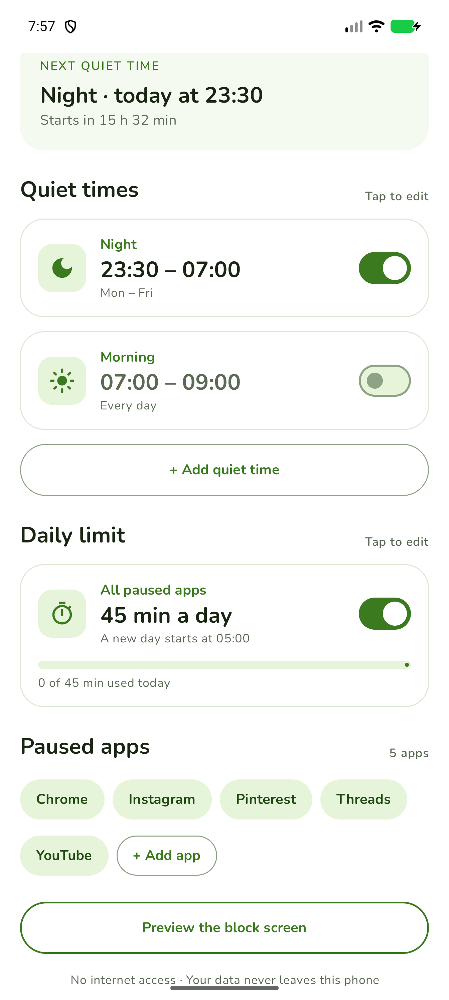
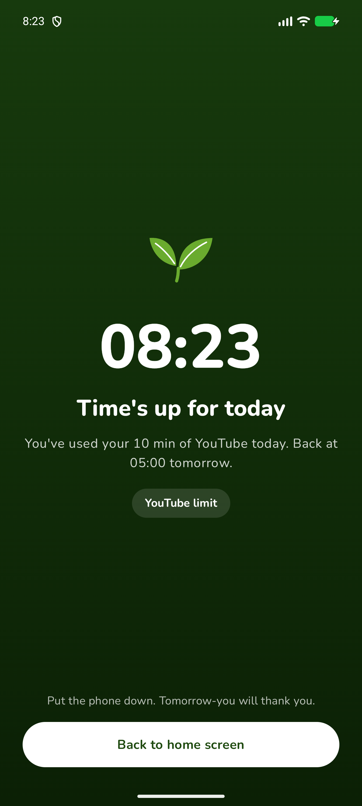
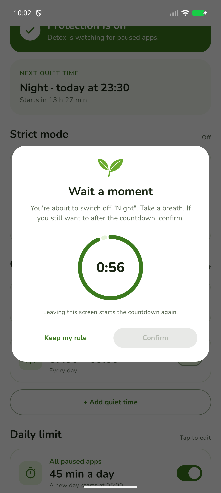
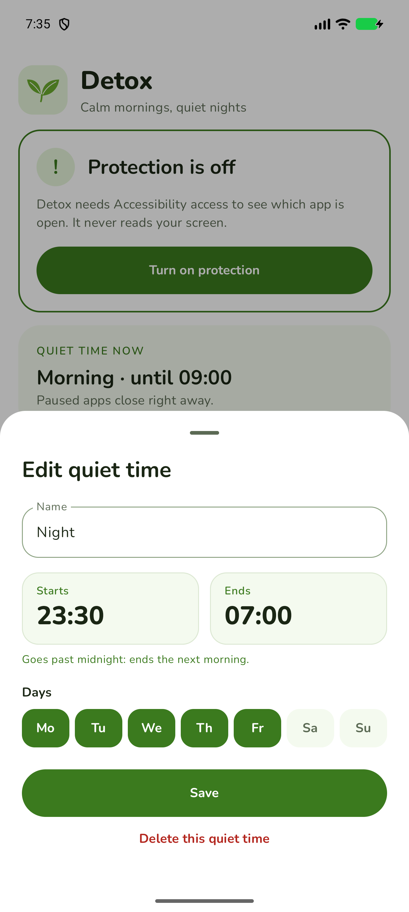
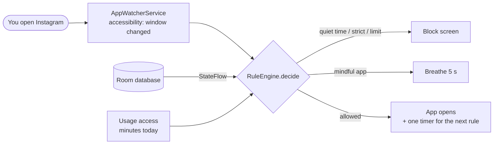

<div align="center">


# Detox

**A privacy-first Android app that makes your phone boring when it should be.**

Block social media during your quiet times, set daily limits, and turn your home screen
into a calm, icon-free list. There is no internet permission, so nothing ever leaves your phone.


&nbsp;
&nbsp;
&nbsp;


</div>

---

## Why

I kept doom-scrolling around midnight. Android's own screen-time limits are one tap away from
"ignore", and the popular blocker apps want broad permissions *and* internet access.

So I built my own. Detox is small, local-only and strict on purpose: loosening any rule
takes a countdown, and the phone itself gets boring.

## Features

| | |
|---|---|
| 🌙 **Quiet times** | Night, morning, or your own windows (they can cross midnight). Paused apps are closed the moment they open. |
| ⏱️ **Daily limits** | A shared budget for all paused apps (e.g. 45 min/day) plus optional per-app limits. "A new day" starts at a time you choose. |
| 🍃 **Strict mode: Detox Home** | Detox becomes your home screen: a big clock, the date, a quote and 5 apps as plain text. Page 2 has search with an A–Z scroller. Paused apps vanish and are blocked all day. |
| 🫁 **Mindful pause** | Mark an app as "mindful" and it opens only after a 5-second breathing screen. After that you get 10 calm minutes. |
| ⏳ **Countdown before loosening** | Turning off a quiet time, raising a limit, unpausing an app or leaving strict mode means waiting 30 s – 10 min *inside the app*. Leaving the app resets the countdown. Making rules stricter is instant. |
| 🛡️ **Self-healing (optional)** | After a one-time USB command, Detox switches protection back on if it gets disabled behind its back. |
| 🎨 **Calm looks** | Paper, Sand, Mist and Night themes, your own photo as wallpaper, automatic Night during quiet time. Nunito font, no app icons on the strict home. |

## Privacy

Privacy is the reason this app exists, so it is enforced by the code, not by a promise:

- **No `INTERNET` permission.** It is explicitly removed in the manifest (`tools:node="remove"`), so Android itself prevents any network access.
- **It can't read your screen.** The accessibility service listens only to "a new window opened" events and has `canRetrieveWindowContent="false"`: no texts, chats or passwords.
- **No backups to the cloud** (`allowBackup="false"`). Your rules live in a local SQLite database (Room).
- **No analytics, no ads, no accounts.**

### Permissions, and why each is needed

| Permission | Why | Needed for |
|---|---|---|
| Accessibility service | To notice *which* app opens (package name only) | Everything (required) |
| Usage access | Counts minutes for daily limits, screen time and recent apps | Limits, Detox Home |
| Battery: no restrictions | Some phones (HiOS, MIUI…) kill background services | Reliability |
| Default home app | Detox Home replaces the launcher in strict mode | Strict mode |
| `WRITE_SECURE_SETTINGS` (granted via adb) | One-tap protection switch + self-healing | Optional |

## How it works



- **`RuleEngine`** is pure Kotlin with no Android code: you pass it `now`, the rules and the usage, and it returns `Allow` or `Block(reason, until)`. That makes every rule unit-testable on a PC.
- **One timer instead of polling:** when a paused app is allowed, the service schedules a single re-check for the moment the next quiet time starts or the limit runs out.
- **The database is the single source of truth.** Room's live queries feed `StateFlow`s that both the UI and the service read.

## Getting started

Detox is built from source. You need Android Studio (or JDK 17+ and the Android SDK) and a phone with USB debugging.

```bash
git clone https://github.com/SauletTheBest/Detox.git
cd Detox
./gradlew assembleRelease
adb install app/build/outputs/apk/release/app-release.apk
```

> The release build is signed with your local debug key, which is fine for installing on your own phone. To distribute it, create your own signing key.

Then on the phone:

1. Open **Detox** → *Turn on protection* → enable **Detox** in Accessibility.<br/>
   *Android 13+ says "Restricted setting"?* Open App info → ⋮ → **Allow restricted settings**, then try again.
2. Allow **Usage access** (for limits and screen time).
3. *Settings → Keep Detox running*: battery **no restrictions**. On HiOS/MIUI, also allow **auto-start**.
4. Optional, **one-tap mode** (self-healing protection):
   ```bash
   adb shell pm grant com.detox.app android.permission.WRITE_SECURE_SETTINGS
   ```
   Undo any time with `pm revoke` and the same arguments.

## Project structure

```
app/src/main/java/com/detox/app/
├── domain/          # pure Kotlin: QuietWindow, RuleEngine, UsageCalculator, MindfulGate…
├── data/            # Room database (entities, DAOs, migrations), RulesRepository, WallpaperStore
├── ui/
│   ├── home/        # main screen: quiet times, limits, strict mode
│   ├── settings/    # "Keep Detox running" switches, home-screen looks
│   ├── launcher/    # Detox Home: two-page strict launcher, A–Z scroller, quotes
│   ├── block/       # the block screen
│   ├── pause/       # mindful pause ("take a breath")
│   └── common/      # countdown dialog, help dialogs
├── AppWatcherService.kt   # the accessibility "bouncer"
└── ProtectionGuard.kt     # self-healing protection
```

### Database (Room, schema v5)

| Table | What it stores |
|---|---|
| `quiet_window` | Start/end as minutes after midnight, days as a bitmask (Mon = 1 … Sun = 64) |
| `paused_app` | Paused apps and their optional own daily limit |
| `settings` | One row: daily limit, day start, strict mode, countdown, protection wanted |
| `home_prefs` | One row: Detox Home theme, wallpaper, quote, gestures |
| `app_pref` | Per app: favorite position (NULL = not on home), hidden, mindful |

Every schema change ships with a hand-written migration (`MIGRATION_1_2` … `MIGRATION_4_5`), so updates never lose your rules. The exported schemas are in `app/schemas/`. To look inside a debug build's database, use `scripts/show_db.py`.

## Tests

```bash
./gradlew testDebugUnitTest
```

There are 64 JVM unit tests: quiet windows across midnight, the rule engine (quiet time, strict mode and limits), usage counting, "is this edit at least as strict?" (checked minute by minute over a whole week), favorites ordering, the mindful gate, and editing the accessibility settings list without touching other apps.

## Roadmap

- [ ] Stats: "Instagram tried 7 times last night", screen time per day
- [ ] Grayscale screen during quiet time
- [ ] Periodic self-healing (every 15 min)
- [ ] Russian & Kazakh translations
- [ ] Export / import rules to a file

## Credits

- Font: [Nunito](https://github.com/googlefonts/nunito) by The Nunito Project Authors, under the SIL Open Font License 1.1 (see `licenses/`).
- Inspired by the idea of a minimalist, "boring" phone.

## License

[MIT](LICENSE)
